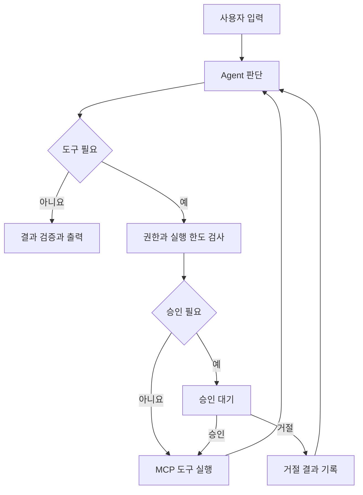

# Flowly Agentic Workflow — Codex 개발 가이드

작성일: 2026-10-21

이 문서는 Codex로 개발을 이어가기 위한 요구사항·시작 프롬프트·작업 지침을 한 파일로 모은 것입니다. 기존 앱은 화면·저장·자료 공유를 구현한 상태이고, 실제 AI·MCP 실행 엔진은 다음 개발 범위입니다. 함께 제공한 flowly-codex.zip에는 기존 소스와 아래 문서가 각각의 파일로 포함되어 있습니다.


---

문서 위치: `CODEX_START.md`

# Codex에서 Flowly Agentic Workflow Builder 만들기

작성일: 2026-10-21

## 목표

현재 Flowly의 한국어 화면과 자료 공유 기능을 기반으로, 일반 사용자가 노드를 연결하고 AI가 허용된 도구를 선택·실행하는 **Agentic Workflow Builder**를 개발합니다. Codex는 이 제품을 개발하는 도구이며, 제품 안에서 동작할 AI 실행 엔진은 별도로 구현합니다.

## 먼저 알아둘 현재 상태

- 기존 소스는 `b84ee49d4c7b381095192f38a899fb21e8e11d5e` 커밋의 스냅샷입니다.
- 로그인 화면, 워크플로 편집, 자료 CRUD, 개인·지정·전체 공유, 저장과 미리보기 기록은 구현되어 있습니다.
- 외부 LLM 호출, 실제 MCP 호출, Agent 반복, 승인·재개, 실행 체크포인트는 아직 구현되어 있지 않습니다.
- 현재 인증은 Sites의 ChatGPT SSO, DB는 Cloudflare D1입니다. 다른 서버에 배포할 때 인증과 DB 연결을 별도로 구현해야 합니다.
- 이번 전달 자료는 기존 소스와 후속 개발 명세입니다. 실제 실행 엔진이 추가로 완성되었다는 의미는 아닙니다.

## 사용하는 순서

1. 소스 ZIP을 풀고 `flowly-codex` 폴더를 Codex 작업 폴더로 엽니다. 원격 환경이라면 이 폴더를 사용자의 개발 저장소로 올린 뒤 해당 저장소를 연결합니다.
2. 프로젝트 루트의 `AGENTS.md`, 이 파일, `docs/AGENTIC_WORKFLOW.md`, `docs/IMPLEMENTATION_PLAN.md`를 읽게 합니다.
3. 아래 시작 프롬프트를 전달합니다.
4. 첫 작업은 현재 환경에서 앱을 실행할 수 있는 기반과 인증·저장·실행 어댑터 경계를 만드는 것입니다. 이후 명세의 마일스톤을 순서대로 구현합니다.

`AGENTS.md`는 Codex가 프로젝트 지침을 읽는 파일입니다. 사용자가 제품 안에서 등록하는 Skill과는 별개입니다. 공식 문서: https://developers.openai.com/codex/guides/agents-md

## Codex에 붙여 넣을 시작 프롬프트

```text
이 저장소를 기반으로 일반 사용자를 위한 한국어 Agentic Workflow Builder를 개발해 주세요.

먼저 AGENTS.md, CODEX_START.md, README.md,
docs/AGENTIC_WORKFLOW.md, docs/IMPLEMENTATION_PLAN.md를 읽고 실제 소스를 확인하세요.

제품 요구사항:
1. 첫 접속 시 SSO 로그인 화면을 표시하고, 로그인한 사용자만 개인 작업 공간에 접근한다.
2. 사용자가 블록과 연결선을 편집해 AI 워크플로를 만들고 저장한다.
3. '도구 및 자료' 별도 페이지에서 MCP, Skill, Prompt, Document를 등록·수정·삭제한다.
4. 자료 공유는 나만 사용 / 지정 사용자 / 전체 사용자로 구분한다.
5. 공유 대상은 읽고 자기 워크플로에서 사용할 수 있으며, 원본 수정·삭제는 소유자만 할 수 있다.
6. Agent는 허용된 자료와 도구를 사용해 결과를 확인하고 필요하면 한도 안에서 다시 실행한다.
7. 외부 변경 작업은 설정된 승인 정책에 따라 정확한 도구와 인자를 제시한 뒤 실행한다.
8. 실행 상태, 도구 호출, 결과, 실패, 승인 대기와 재개를 서버에 기록한다.

현재 UI와 자료 권한 검사를 최대한 재사용하세요.
현재 simulateFlow()는 미리보기이며 실제 AI 실행으로 표시하지 마세요.
기존 기능을 유지하면서 실제 실행을 별도 runtime 계층으로 추가하세요.
캔버스 바깥 그래프는 MVP에서 DAG로 유지하고, Agent 노드 내부에 제한된 도구 호출 반복을 구현하세요.

이번 작업의 기본 방향은 독립적인 Codex 개발 환경에서 로컬 개발이 가능한 구조입니다.
기존 Sites 배포를 계속 사용하는 경우에는 해당 호스팅 프로필을 유지하세요.
현재 인증 헤더를 일반 서버의 인증 수단으로 그대로 사용하지 마세요.
환경 결정과 현재 실행 가능한 범위를 docs/IMPLEMENTATION_PLAN.md에 기록하세요.

계획만 제시하고 끝내지 말고, P0를 구현·검증한 뒤 의존성이 충족된 다음 단계로 진행하세요.
첫 실제 실행은 '입력 → Agent → 읽기 전용 도구 1개 → 답변'으로 완성하세요.
이후 승인·재개, 버전 고정, 공유 철회 재검사, 재시도와 복구를 추가하세요.

API 키와 SSO 설정이 없으면 외부 호출을 숨겨서 흉내 내지 마세요.
결정적인 테스트 어댑터로 개발을 진행하고, 실제 연결은 설정 필요 상태로 표시하세요.
기존 자격 증명은 허용된 환경·목적에 한해 사용하고, 필요한 값은 안전한 설정 경로를 안내하세요.

가능하면 UI, 도메인·권한, 실행 엔진, 검증 작업을 파일 소유권을 나누어 병렬 진행하세요.
스키마와 API 계약은 먼저 합의하고 하나의 담당자가 통합하세요.
각 단계에서 변경 사항, 테스트 결과, 남은 설정을 보고하세요.
```

## 환경과 실행에 관한 안내

현재 저장소의 `package.json`은 Node `>=22.13.0`, `pnpm@11.25.0`을 지정하고 있습니다. 이 값은 전달한 소스의 요구사항이며 최신 버전 추천이 아닙니다.

실제 스크립트는 `dev`, `build`, `start`, `lint`, `db:generate`이며, 개발·빌드가 `scripts/run-framework.mjs`를 거치는 Vinext/Workers 프로젝트입니다. `npm run dev`만으로 일반적인 Next.js 서버와 동일하게 동작한다고 가정하지 마세요. 설치 전 현재 환경, 잠금 파일, 설치 스크립트를 확인하고 이식이 필요하면 별도 작업으로 기록합니다.

기존 소스에서 확인된 타입 검사 명령:

```bash
node node_modules/typescript/bin/tsc --noEmit --incremental false
```

의존성이 설치되어 있어야 실행할 수 있습니다. 새 개발 환경에서의 설치·실행 검증은 P0의 완료 조건입니다. Sites용 설정과 인증 경로가 그대로 포함되어 있으므로, 독립 서버 배포의 첫 작업에서 이 경계를 처리해야 합니다.

## 자료 구성

| 파일 | 용도 |
| --- | --- |
| `AGENTS.md` | Codex의 상시 개발·검증 지침 |
| `CODEX_START.md` | 시작 방법과 첫 작업 프롬프트 |
| `docs/AGENTIC_WORKFLOW.md` | 제품 요구사항, 권한, 실행 구조, 데이터·API 설계 |
| `docs/IMPLEMENTATION_PLAN.md` | 순차 구현 단계와 테스트 수용 기준 |
| `docs/SOURCE_SNAPSHOT.md` | 기존 구현의 출처와 이식 시 유의점 |
| `README.md` | 현재 구현된 앱의 설명과 범위 |

현재 화면 참고: https://flowly-ai-studio.shun94.chatgpt.site

이 링크는 소유자 전용 접근 정책이 적용된 기존 사이트입니다. 소스 ZIP을 받거나 명세를 읽는 것만으로 사이트 접근 권한이 바뀌지는 않습니다.


---

문서 위치: `docs/AGENTIC_WORKFLOW.md`

# Flowly Agentic Workflow Builder — 개발 명세

작성일: 2026-10-21 · 상태: 후속 구현을 위한 제안 명세

현재 구현 사실은 `SOURCE_SNAPSHOT.md`와 실제 소스를 기준으로 한다. 이 문서의 '목표', '추가', '권장' 항목은 앞으로 구현할 내용이다.

## 1. 제품 정의

일반 사용자가 코드를 작성하지 않고 **입력 → AI 작업 → 도구 사용 → 조건 판단 → 결과**를 설계하는 한국어 웹 서비스다. AI 작업에는 필요한 정보를 찾고, 허용된 도구를 선택하고, 결과가 충분한지 판단하며, 정해진 한도 안에서 다시 시도하는 Agent 실행을 포함한다.

사용자가 원하는 세 가지 핵심은 다음과 같다.

1. 웹의 workflow diagram으로 AI를 만들 수 있다.
2. 별도 '도구 및 자료' 페이지에서 사용자가 만든 MCP·Skill 등을 등록·삭제하고, 개인·지정 사용자·전체 사용자 범위로 공유한다.
3. 초기 접속은 SSO 로그인 화면으로 시작한다.

제품의 핵심은 AI 모델을 새로 학습하는 기능이 아니라, 모델·지침·자료·도구·실행 정책을 조합하는 기능이다.

### 구분할 세 가지 개념

| 개념 | 역할 |
| --- | --- |
| Codex와 프로젝트 `AGENTS.md` | 개발자가 웹앱을 구현할 때 사용하는 개발 도구와 지침 |
| 제품의 Agent 실행 엔진 | 사용자의 요청에 맞춰 모델과 도구를 실행하는 서버 기능 |
| 사용자가 등록한 Skill | 특정 작업의 절차·기준·출력 형식을 설명하는 재사용 지침 |

제품 내 Skill을 등록하는 행위가 Codex 환경의 Skill을 설치하는 행위로 이어지지는 않는다.

## 2. 현재 구현과 목표 사이의 차이

| 영역 | 현재 구현 | 목표 |
| --- | --- | --- |
| 로그인 | Sites ChatGPT SSO | 기존 SSO 유지 또는 독립 환경의 검증된 SSO 어댑터 |
| 편집기 | 6종 노드, 연결·이동·삭제, 확대·축소, undo/redo | 기존 기능 + Agent 설정·도구 연결·승인 상태 |
| 실행 | `simulateFlow()` 미리보기 | 실제 모델·도구 실행, 한도 있는 반복 |
| 조건 | 최초 입력의 문자열 포함 여부 | 선택한 앞 단계 출력의 값·스키마를 기준으로 평가 |
| 자료 | 등록·수정·삭제·공유 | 기존 기능 + 버전·연결 상태·호출 권한 |
| 기록 | 완료된 미리보기와 단계 | 실행 중·승인 대기·실패·취소·재개, 이벤트·체크포인트 |
| 공유 | 서버에서 개인·이메일 지정·전체 읽기 검사 | 실행 직전·재개 시점까지 같은 권한 정책 적용 |

현재 화면과 권한 기능을 재사용하고 실제 실행 계층을 추가한다. 캔버스 전체를 다시 작성하는 것은 선행 조건이 아니다.

## 3. 사용자 흐름과 화면

### 기본 사용자 여정

SSO 로그인 후 예제를 고르거나 새 워크플로를 만든다. 필요한 자료·Skill·MCP를 선택하고 Agent의 목표와 출력 형식을 지정한다. 먼저 연결을 검사하고 실행 입력을 넣는다. 실행 중 현재 단계와 도구 호출을 확인한다. 승인이 필요한 동작이 있으면 정확한 변경 내용을 확인하고 승인 또는 거절한다. 결과와 실행 기록을 저장한다.

### 페이지별 요구사항

| 화면 | 주요 내용 | 완료 기준 |
| --- | --- | --- |
| 로그인 | 서비스 설명, 활성화된 SSO 공급자, 로그인 실패·재시도 | 인증 없는 사용자는 개인 API에 접근할 수 없음 |
| 내 워크플로 | 생성·검색·복제·삭제, 최근 수정, 버전 | 다른 사용자의 워크플로는 노출되지 않음 |
| 편집기 | 팔레트, 캔버스, 속성 패널, 검사, 저장, 실행 | 앞 노드 출력과 다음 노드 입력을 명시적으로 연결 가능 |
| 도구 및 자료 | 유형·소유자·공유 범위·버전·연결 상태, CRUD | 공유 대상만 읽고 사용할 수 있고 소유자만 원본 변경 |
| 실행 기록 | 상태·소요 시간·단계·도구·결과·오류 | 새로고침 후에도 같은 실행 상태를 조회 가능 |
| 승인함 | 대기 작업, 도구·대상·인자·영향·만료 시각 | 지정 승인자만 승인·거절 가능 |
| 설정 | SSO/연결 상태, 사용자 연결, 실행 한도 | 비밀 값 원문은 조회·내보내기되지 않음 |
| 가이드 | 쉬운 용어, 예제, 참고 링크 | MCP·Skill·Agent의 차이를 설명 |

'미리보기', '테스트 실행', '실제 실행'은 버튼과 결과에 표시한다. 설정이 없으면 실제 실행 버튼에 연결이 필요한 이유를 보여 준다.

## 4. Agentic 실행 모델

### 4.1 기본 그래프와 Agent 노드

MVP의 외부 워크플로 그래프는 DAG를 유지한다. 기존 순환 검증을 삭제하는 방식으로 반복을 구현하지 않는다. Agent 노드 내부에서만 한도가 있는 모델·도구 호출 반복을 허용한다.



도구 실행 직전에 권한을 다시 검사한다. 승인 거절은 도구를 실행하지 않은 관찰 결과로 Agent에 전달한다. Agent가 같은 동작을 이름이나 인자 표현만 바꾸어 반복 요청하지 못하도록 거절 기록과 한도를 적용한다.

### 4.2 노드 종류

| 노드 | 역할 | 핵심 설정 |
| --- | --- | --- |
| Input | 사용자 요청을 입력 스키마로 받음 | 필수 필드·크기·형식 |
| Context | 권한 있는 문서·프롬프트를 문맥으로 제공 | 리소스 ID·버전·사용 필드 |
| Skill | 작업 절차·출력 규칙을 선택한 AI 노드에 적용 | Skill 버전·적용 대상 |
| LLM | 지정된 입력으로 모델을 한 번 호출 | 모델 프로필·프롬프트·출력 스키마 |
| Agent | 목표에 맞춰 모델과 도구 사용을 반복 | 목표·허용 도구·Skill·종료 기준·한도 |
| Tool | 지정된 도구를 명시적인 인자로 실행 | 연결·도구 이름·입력 매핑·승인 정책 |
| Condition | 앞 단계 출력으로 분기 | 대상 필드·연산자·비교값 |
| Approval | 특정 결과 또는 제안된 행동을 사람이 검토 | 승인자·내용·만료·거절 경로 |
| Output | 검증된 결과를 표시 | 텍스트·Markdown·JSON |

이 표는 목표 도메인 모델이다. 기존 노드를 한 번에 모두 변경할 필요는 없다. 첫 Agent 기능에서는 Inspector 설정과 실행 상세 화면으로 도구·승인을 표현할 수 있다.

### 4.3 입력·출력과 그래프 버전

- 그래프 JSON에 `schemaVersion`을 추가한다. 현재 문서는 v1로 해석한다.
- v1 `ai` 노드는 자동으로 자율 Agent가 되지 않게 한다. 호환 가능한 1회 모델 노드로 변환하고, 실제 모델 설정은 사용자가 지정하도록 한다.
- 이전 `resource`가 MCP를 참조하더라도 도구가 임의로 호출되지 않는다. 실제 연결과 허용 도구를 선택해야 한다.
- 각 노드는 입력·출력 스키마와 `inputBindings`를 가진다. 예: `draft.text`를 다음 노드의 `content`로 전달한다.
- 조건은 JSON 경로와 허용된 연산자로 평가한다. 사용자 문자열을 `eval`하지 않는다.
- 분기 합류의 MVP 의미는 '활성화된 선행 노드 완료를 기다린 뒤 명시된 필드로 병합'이다. 같은 출력 필드 충돌은 오류로 표시한다.
- 실행에 사용하는 정의·자료·Skill 버전은 시작할 때 고정한다. 이후 초안 편집은 진행 중 실행을 바꾸지 않는다.

### 4.4 실행 한도

아래 수치는 초기 설계를 위한 제안값이며 공급자 제한이나 검증된 성능 수치가 아니다.

| 항목 | 제안 기본값 | 동작 |
| --- | --- | --- |
| Agent 모델 턴 | 8회 | 초과 시 종료 사유와 현재 결과 표시 |
| 도구 호출 | 12회 | 무한 도구 호출 방지 |
| 활성 실행 시간 | 120초 | 승인 대기 시간은 별도로 관리 |
| 개별 도구 제한 시간 | 20초 | 도구별 재정의 가능 |
| 전체 토큰 예산 | 8,000 | 공급자 사용량에 따라 누적; 다음 호출 전 잔여량 검사 |
| 승인 유효 기간 | 24시간 | 만료 후 기존 승인으로 실행하지 않음 |

토큰·시간 사용량은 외부 호출의 반환 시점에 확정되는 부분이 있다. 서버는 호출 전 설정 가능한 출력 상한과 남은 예산을 적용하고, 반환 직후 누적치를 갱신한다. 비용 정보가 없으면 추정 비용을 확정 비용처럼 표시하지 않는다.

## 5. 도구 및 자료 관리

### 5.1 자료 유형

| 유형 | 사용자가 등록하는 내용 | 실제 사용 방식 |
| --- | --- | --- |
| MCP 정의 | 서버 주소·설명·노출된 도구 정보 | 별도 연결 자격 증명과 결합해 서버가 호출 |
| Skill | 작업 절차·판단 기준·출력 형식 | 선택된 AI 작업의 지침으로 적용 |
| Prompt | 재사용 프롬프트와 입력 변수 | 검증한 변수를 넣어 모델 입력 구성 |
| Document | 텍스트·Markdown·JSON 자료 | 직접 문맥으로 제공; 검색 색인은 후속 단계 |

MCP는 외부 기능을 표준 인터페이스로 제공하는 방식이며, 서버는 tools·resources·prompts를 구분한다. 앱의 '자료 카탈로그'와 MCP 프로토콜의 resources는 같은 개념으로 취급하지 않는다. [R4]

초기 Skill은 텍스트 지침으로 제한한다. 업로드한 스크립트·패키지를 서버 권한으로 실행하는 기능은 MVP에 포함하지 않는다. Skill이 요구하는 도구는 후보 목록이며, 최종 도구 집합은 사용자 선택·자료 권한·연결 권한·서버 정책의 교집합이다.

### 5.2 공유 권한

| 공유 범위 | 소유자 | 지정 사용자 | 그 외 로그인 사용자 | 비로그인 사용자 |
| --- | --- | --- | --- | --- |
| 나만 사용 | 조회·사용·수정·삭제 | 불가 | 불가 | 불가 |
| 지정 사용자 | 조회·사용·수정·삭제 | 조회·사용 | 불가 | 불가 |
| 전체 사용자 | 조회·사용·수정·삭제 | 조회·사용 | 조회·사용 | 불가 |

이 제품에서 '전체 사용자'는 서비스에 로그인하고 접근할 수 있는 전체 사용자다. 인터넷의 익명 사용자에게 내용을 공개하는 기능은 별도 요구사항이다.

지정 공유는 사용자 선택을 우선하고, 아직 등록되지 않은 사용자는 검증된 이메일과 나중에 연결할 수 있게 한다. 이메일 문자열만 입력했다고 계정을 생성하거나 초대 메일을 자동 발송하지 않는다. 이메일 대소문자는 정규화하되 임의의 점·접미사를 제거해 다른 계정을 합치지 않는다.

원본 편집 권한을 공유받은 사용자에게 자동으로 주지 않는다. 복제 허용 여부는 자료 정책에 따라 표시한다. 복제를 허용한 콘텐츠는 나중에 원본 공유를 철회해도 이미 만든 독립 사본까지 회수할 수 없음을 안내한다.

### 5.3 MCP 정의와 연결 자격 증명의 분리

공유 가능한 객체는 '어떤 도구인지'를 설명하는 정의다. 실제 호출에 사용하는 외부 서비스 토큰·OAuth 연결은 별도 객체다.

예를 들어 공개된 '문서 검색 MCP'를 선택한 사용자는 자신의 문서 계정으로 연결해야 한다. 별도로 승인된 조직 공용 연결이 있다면 해당 연결의 사용 권한을 검사한다. 정의를 공개한 사용자의 토큰을 다른 사용자에게 제공하지 않는다.

MCP 등록·연결 흐름:

1. 정의를 등록하고 유효한 주소·형식인지 확인한다.
2. 사용자가 자신의 연결을 만들거나 허용된 조직 연결을 선택한다.
3. 서버가 MCP 연결과 제공 도구를 확인한다.
4. 사용할 도구를 선택하고 입력 스키마·승인 정책을 확인한다.
5. 실행할 때마다 현재 연결·자료 접근 권한을 확인한다.

원격 MCP 주소는 서버 측 네트워크 정책을 적용한다. 공용 환경의 루프백·사설망·메타데이터 주소 접근, 리다이렉트 우회, URL에 포함된 자격 증명을 차단한다. 사내망 연결이 필요하면 별도의 승인된 게이트웨이 설계로 확장한다. 브라우저가 임의 서버에 토큰을 전송하는 구조로 만들지 않는다.

### 5.4 삭제·철회·버전

- 기존 저장 흐름과 호환되도록 본인의 저장 워크플로가 참조 중인 자료는 참조를 해제하도록 안내하고 삭제를 거절할 수 있다.
- 다른 사용자가 참조했다는 이유로 그 사용자의 워크플로 이름이나 내용을 노출하지 않는다.
- 삭제 또는 공유 철회 후 새로운 조회·실행·도구 호출·승인 재개를 차단한다.
- 버전을 고정했더라도 현재 권한 검사까지 우회하지 않는다.
- 이미 외부로 전달되었거나 완료된 작업은 자동으로 회수할 수 없다. 실행 이력과 취소 가능 범위를 구분한다.
- 감사 기록 보존과 콘텐츠 영구 삭제의 관계는 운영 정책으로 정하고 UI와 API에 일관되게 적용한다.

## 6. 인증과 시스템 구성

### 6.1 인증

현재 Sites 프로필은 기존 ChatGPT SSO를 유지한다. 독립 배포 프로필은 검증된 OIDC 라이브러리를 이용한 SSO 어댑터를 구현한다. 구체적인 조직 공급자는 아직 지정되지 않았으므로 Google Workspace·Microsoft Entra ID·기타 OIDC 중 실제 도입 환경에 맞게 설정한다.

계정의 소유권은 이메일 자체가 아니라 내부 사용자 ID와 검증된 외부 계정 식별자에 연결한다. 다른 공급자가 같은 이메일을 반환했다는 이유만으로 계정을 자동 병합하지 않는다. 로그인·로그아웃·세션 만료·인증 실패·허용된 복귀 경로를 처리한다.

Sites 프록시 밖에서 `oai-authenticated-*` 헤더를 일반 사용자가 보낸 값 그대로 신뢰하지 않는다. API는 인증 어댑터가 검증한 세션만 사용한다. 로컬 테스트의 가짜 세션은 명시적인 테스트 환경에만 존재하고 운영 설정에서 활성화되지 않게 한다.

### 6.2 권장 구현 방향

현재 TypeScript UI를 재사용하는 전제에서 아래를 제안한다. 프레임워크 선택은 프로젝트 요구사항이며 이미 설치되었다는 의미가 아니다.

| 계층 | 권장 방향 | 이유 |
| --- | --- | --- |
| 웹 UI | 기존 React·TypeScript 화면 재사용 | 현재 편집기와 자료 관리 기능 보존 |
| HTTP API | 현재 UI와 호환되는 서버 API, 인증·권한을 도메인 함수로 분리 | 실행·저장 로직을 명확히 구분 |
| 실행 엔진 | TypeScript LangGraph를 Node 실행 서비스에서 사용 | Agent 반복·상태·승인 재개 구현에 적합한 후보 |
| 모델 호출 | 공급자와 모델을 설정으로 받는 어댑터 | 특정 제공자·모델명을 UI에 고정하지 않음 |
| 영속 데이터 | 기존 프로필은 D1; 독립 서버 목표는 PostgreSQL과 Drizzle | 새 환경에서는 실행 상태·버전·권한을 일관되게 관리 |
| 실행 작업 | DB에 영속 작업을 기록하고 별도 worker가 처리 | 요청 연결이 끊겨도 실행과 승인 대기를 유지 |
| 이벤트 | 저장된 이벤트를 SSE 또는 폴링으로 제공 | 실행 상태 재연결과 단계별 표시 |
| 파일 검색 | 후속 단계에 별도 파일 저장·검색 색인 | 텍스트 자료 기능과 독립적으로 확장 |

LangGraph는 실행 상태의 체크포인트와 interrupt/resume을 제공한다. 운영에서 재개를 보장하려면 영속 체크포인터를 구성해야 한다. 이 기능이 외부 서비스의 중복 쓰기까지 자동 해결하는 것은 아니므로 도구 실행 기록과 재시도 정책을 별도로 둔다. [R2][R3]

첫 구현에서 LangGraph와 다른 에이전트 프레임워크를 동시에 기본 엔진으로 넣지 않는다. OpenAI Agents SDK도 대안이 될 수 있지만 엔진 변경은 어댑터 뒤에서 평가한다. 도구 실행을 승인 대기로 중단하고 상태를 저장해 재개하는 구조는 공식 SDK 지침에서도 설명한다. [R5]

### 6.3 배포 프로필 결정

**기본 권장:** 독립 Codex 개발 환경에서 기존 UI를 재사용하고, 일반 서버 인증과 PostgreSQL 저장 어댑터 및 Node 실행 worker를 구성한다. 현재 D1 데이터를 사용할 필요가 있으면 이관 계획을 작성한다. 화면 전체나 캔버스까지 교체할 필요는 없다.

**기존 Sites를 계속 사용하는 경우:** 기존 인증·D1을 유지하고 실행 서비스와의 인증된 내부 연결을 설계한다. 권한의 원본은 기존 API가 유지하며 worker는 시작·호출·재개 시마다 권한 서비스를 조회한다. 브라우저가 임의 사용자 ID로 worker를 직접 호출할 수 없게 한다. API와 실행 작업 저장 사이에는 outbox 등 복구 가능한 전달 방식을 사용한다.

P0에서는 둘 중 현재 환경에 맞는 하나의 배포 프로필을 결정하고 기록한다. MVP에서 두 프로필을 모두 완전하게 운영 지원하려고 범위를 늘리지 않는다. 선택한 프로필에서 기존 사용자 기능을 보존하는 것이 우선이다.

### 6.4 권장 코드 경계

| 경계 | 책임 |
| --- | --- |
| `domain/workflow` | 버전 있는 그래프 타입, 검증, 변환, 입력·출력 매핑 |
| `domain/resources` | 자료 버전·공유 정책·삭제 정책 |
| `server/auth` | 검증된 사용자·세션, 공급자 어댑터 |
| `server/repositories` | DB 접근과 트랜잭션 |
| `server/connections` | 외부 서비스 연결·비밀 참조·사용 권한 |
| `runtime/compiler` | UI 그래프를 실행 가능한 정의로 변환 |
| `runtime/nodes` | LLM·Agent·Tool·Condition·Output 실행 |
| `runtime/policy` | 권한·승인·한도·도구 입력 검증 |
| `runtime/worker` | 작업 획득·리스·실행·체크포인트·재개 |
| `runtime/events` | 사용자에게 공개 가능한 실행 이벤트 |

디렉터리 이름은 제안이다. 먼저 현재 파일에서 책임을 분리하고, 필요한 경계만 점진적으로 만든다.

## 7. 데이터 모델과 API 계약

### 7.1 주요 데이터

| 객체 | 주요 필드와 역할 |
| --- | --- |
| User / Identity | 내부 사용자 ID, 공급자와 subject, 검증 이메일 |
| Resource | 소유자, 종류, 표시 정보, 공유 범위, 현재 버전, 삭제 상태 |
| ResourceGrant | 대상 사용자 또는 검증 대기 이메일, 사용 권한 |
| ResourceVersion | 변경 불가능한 내용·스키마·정의의 버전 |
| Connection | 외부 서비스, 연결 소유자, 비밀 참조, 허용 주체, 상태 |
| Workflow / WorkflowVersion | 소유자, 초안, 고정된 그래프 정의와 schemaVersion |
| Run | 실행 주체, 버전, 모드, 상태, 예산, 시작·종료 시각, 오류 코드 |
| RunStep / ToolCall | 노드·반복 회차, 입력·출력 참조, 시도 번호, 부작용 결과 |
| Approval | 실행·호출·인자 해시·승인자·상태·만료·결정 시각 |
| Checkpoint | 실행 상태와 진행 위치; 소유자 범위로 접근 제한 |
| RunEvent | 순서 번호, 공개 가능한 상태 변화, 재연결 커서 |
| Job / Outbox | 실행 요청의 영속 전달, 중복 방지 키, worker 리스 |

비밀 정보는 내용 테이블과 분리한다. 실행 JSON 내보내기에는 자격 증명·공유 대상 이메일 목록·다른 사용자의 비공개 자료를 포함하지 않는다. 입력·출력·로그도 민감한 사용자 데이터이므로 같은 권한과 보존 정책을 적용한다.

### 7.2 API 초안

기존 `/api/studio`를 즉시 삭제하지 않는다. 새 API를 추가하거나 호환 어댑터를 두고 UI를 점진적으로 이동한다.

| 메서드·경로 | 동작 |
| --- | --- |
| `GET /api/me` | 검증된 현재 사용자와 기능 설정 |
| `GET, POST /api/resources` | 접근 가능한 자료 조회·신규 등록 |
| `PATCH, DELETE /api/resources/:id` | 소유자의 수정·삭제 |
| `PUT /api/resources/:id/sharing` | 소유자의 공유 정책 변경 |
| `POST /api/connections/:id/check` | 사용 권한이 있는 연결 확인 |
| `POST /api/workflows/:id/validate` | 그래프·입력·권한 검증 |
| `POST /api/workflows/:id/versions` | 현재 초안을 변경 불가능한 버전으로 저장 |
| `POST /api/runs` | 검증된 버전으로 실행 요청, 실행 ID 반환 |
| `GET /api/runs/:id` | 본인 또는 승인된 주체의 실행 조회 |
| `GET /api/runs/:id/events` | 인증된 이벤트 스트림과 커서 재연결 |
| `POST /api/runs/:id/cancel` | 취소 요청; 이후 동작을 중단 |
| `POST /api/approvals/:id/decision` | 승인 또는 거절; 같은 실행 재개 |

`POST /api/runs`와 승인 요청은 범위가 있는 idempotency key를 받는다. 같은 사용자가 같은 키로 재전송하면 중복 실행을 생성하지 않는다. 키의 수명과 충돌 응답을 문서화한다. 외부 존재 여부가 민감한 객체는 다른 사용자에게 불필요한 정보를 노출하지 않는 오류를 반환한다.

## 8. 승인·복구·실패 처리

### 8.1 상태

주요 실행 상태는 `queued`, `running`, `waiting_approval`, `succeeded`, `failed`, `cancel_requested`, `cancelled`, `expired`, `budget_exceeded`로 구분한다. 실제 전이 표는 구현 시 테스트 가능한 코드로 둔다.

승인 대기는 HTTP 요청을 계속 열어 두고 기다리는 방식으로 구현하지 않는다. 호출 계획·정규화된 인자·스냅샷·승인 상태를 영속 저장한 뒤 작업을 놓고, 승인 결정 이벤트가 같은 실행을 다시 예약하게 한다.

### 8.2 승인 경계

외부 전송·쓰기·삭제 등 실제 변경 작업은 제품 정책에 따라 승인 대상을 정한다. 단순 읽기는 권한이 있으면 계속 진행할 수 있다. 사용자에게 제시한 대상과 내용이 승인 후 달라지면 기존 승인을 재사용하지 않는다.

승인자는 현재 작업에 대한 승인 권한을 가져야 하며, 승인 버튼을 눌렀다는 사실이 자료·연결 사용 권한까지 새로 부여하지 않는다. 승인 후에도 호출 직전 최신 권한과 연결 상태를 검사한다.

### 8.3 재시도와 중복 부작용

- 입력 오류·권한 없음·스키마 불일치는 무작정 재시도하지 않는다.
- 일시적 읽기 실패는 한도 있는 지수 지연으로 재시도할 수 있다.
- 쓰기는 외부 서비스가 지원하는 idempotency key와 도구 호출 레코드를 함께 사용한다.
- 타임아웃 후 실제 성공 여부가 불명확한 쓰기는 `unknown_outcome` 단계 상태로 표시하고 확인 절차를 거친다. 동일 쓰기를 자동 반복하지 않는다.
- 체크포인트 복구가 이미 완료된 쓰기 작업을 다시 수행하지 않도록 호출 기록을 조회한다.
- 브라우저 종료는 실행 취소와 구분한다. 명시적 취소도 이미 완료된 외부 작업을 자동으로 되돌리지는 않는다.
- worker 리스 갱신·만료와 중복 획득을 고려한다. 작업 전달은 중복 가능하다는 가정으로 처리한다.

### 8.4 사용자에게 보이는 실행 기록

현재 노드, 호출한 도구, 공개 가능한 인자·결과, 소요 시간, 실제 공급자 사용량, 상태 변경, 재시도·승인 이력을 보여 준다. 비밀 값은 기록 전에 제거한다. 모델의 내부 사고 원문을 수집하거나 노출하는 기능은 요구하지 않는다.

## 9. MVP와 후속 범위

### MVP 완료 조건

- 실제 SSO가 적용된 개인 작업 공간과 기존 자료 공유 기능이 동작한다.
- 사용자가 워크플로를 만들고, 실제 모델과 읽기 도구 1개를 사용한 Agent 실행을 완료한다.
- 앞 단계의 출력이 다음 단계 입력과 조건에 실제로 영향을 준다.
- 실행 한도를 초과하면 사용자에게 이유를 표시하고 멈춘다.
- 승인된 변경 작업은 승인 후 실행되고, 거절·만료·권한 철회된 작업은 실행되지 않는다.
- 서버 재시작·브라우저 재연결 후 실행 상태와 승인 대기를 복구한다.
- 외부 쓰기의 불명확한 결과를 성공으로 단정하거나 자동 중복 실행하지 않는다.
- 개인·지정·전체 공유를 서로 다른 사용자 3명으로 검증한다.
- 미리보기와 실제 실행의 상태·데이터·표시를 구분한다.

### 후속 확장

다중 에이전트 역할 분담, 장기 메모리, PDF·파일 저장과 RAG, 예약 실행·웹훅, 그룹 공유, 실행 평가와 품질 대시보드, 템플릿 마켓은 MVP 이후 범위다. 사용자가 요구하지 않은 자율 코드 실행·임의 서버 패키지 설치를 초기 범위에 추가하지 않는다.

## 10. 참고 자료와 근거

### 공식 구현 문서

- [R1] OpenAI, AGENTS.md 프로젝트 지침: https://developers.openai.com/codex/guides/agents-md
- [R2] LangGraph JavaScript, Interrupts: https://docs.langchain.com/oss/javascript/langgraph/interrupts
- [R3] LangGraph JavaScript, Persistence: https://docs.langchain.com/oss/javascript/langgraph/persistence
- [R4] Model Context Protocol, Understanding MCP servers: https://modelcontextprotocol.io/docs/learn/server-concepts
- [R5] OpenAI, Guardrails and human review: https://developers.openai.com/api/docs/guides/agents/guardrails-approvals

위 공식 문서는 2026-10-21에 확인했다. 라이브러리의 설치 버전과 구체적인 API 시그니처는 실제 구현 시 해당 버전 문서로 다시 확인한다. 이 명세의 스택·한도·데이터 모델은 Flowly 요구에 맞춘 제안이며 공식 문서가 지정하는 필수 구조가 아니다.

### 사용자가 제공한 제품·학습 참고

- https://wikidocs.net/book/19654
- https://wikidocs.net/book/19240
- https://rupijun.tistory.com
- https://kbgtools.com/ai-glossary
- https://kbgtools.com/ai-prompt-generator
- https://kbgtools.com/ai-skills
- https://kbgtools.com/ai-prompts
- https://kbgtools.com/ai-md

이 목록은 사용자가 제공한 참고 링크다. 모든 페이지의 상세 내용을 검증했다는 의미는 아니며, 제품 요구사항과 공식 프로토콜 문서를 대신하지 않는다.


---

문서 위치: `docs/IMPLEMENTATION_PLAN.md`

# Codex 구현 계획과 수용 기준

작성일: 2026-10-21

아래 항목은 후속 작업 계획이며 아직 완료된 체크리스트가 아니다. 기존 구현·검증의 기준은 `README.md`와 `SOURCE_SNAPSHOT.md`다.

## 진행 원칙

P0부터 순서대로 진행한다. 각 단계는 사용자가 확인할 수 있는 작은 수직 기능을 완성한다. 실제 자격 증명·외부 SSO 설정이 없으면 결정적인 테스트 어댑터로 코드와 실패 흐름을 검증하고, 실제 연동 검증을 미완료로 남긴다. 이 사유로 관계없는 화면·저장·권한 작업까지 멈추지 않는다.

## P0. 새 Codex 환경에서 기존 앱 실행

### 작업

- 현재 패키지·잠금 파일·빌드 스크립트·SSO·D1 의존을 확인한다.
- 독립 서버 프로필 또는 기존 Sites 프로필 중 하나를 선택하고 결정 이유를 기록한다.
- 선택한 프로필의 개발 실행, 환경 변수 예제, DB 준비 절차를 문서화한다. 예제에는 비밀 값을 넣지 않는다.
- 인증·저장·실행의 어댑터 경계를 만든다. 현재 화면과 자료 공유 로직을 보존한다.
- 새로운 환경에 맞는 최소한의 자동 검사 기반을 마련한다.

### 수용 기준

- [ ] 로그인 화면과 `/demo`를 새 환경에서 표시한다.
- [ ] 실제 인증 또는 명시적인 테스트 인증으로 개인 공간의 저장·조회가 동작한다.
- [ ] 임의 `oai-authenticated-*` 헤더가 독립 서버의 인증을 우회하지 못한다.
- [ ] 개인·지정·전체 공유와 소유자 수정·삭제 권한이 보존된다.
- [ ] 타입 검사와 선택한 환경의 빌드가 통과한다.
- [ ] 설치·DB 준비·실행 명령과 필요한 설정이 README에 재현 가능하게 기록되어 있다.

## P1. 실제 데이터가 흐르는 실행 기반

### 작업

- 그래프 스키마 버전과 v1 변환을 만든다.
- 입력·출력 스키마, 입력 바인딩, 조건 평가를 추가한다.
- 실제 실행과 미리보기를 구분하는 API·Run 모델을 추가한다.
- 영속 작업, 실행 상태, 이벤트, 취소 요청의 최소 경로를 만든다.
- 모델 인터페이스와 결정적인 테스트 어댑터를 만든다.

### 수용 기준

- [ ] 기존 3개 예제가 호환 변환 후 열리고 저장된다.
- [ ] 앞 노드의 출력이 달라지면 다음 노드의 입력과 조건 결과가 달라진다.
- [ ] 잘못된 입력·출력 형식은 해당 노드에서 명확한 오류를 낸다.
- [ ] JSON의 스크립트 문자열이나 순환 연결로 임의 실행을 할 수 없다.
- [ ] 같은 실행 요청 키를 재전송해도 Run이 중복 생성되지 않는다.
- [ ] 새로고침 후 실행 상태를 조회한다.

## P2. 단일 Agent와 읽기 전용 MCP

### 작업

- LangGraph TypeScript 또는 기록한 대안 엔진으로 Agent 내부 반복을 구현한다.
- 모델 제공자 어댑터, 허용 도구 집합, 종료 판단, 단계·시간·토큰 예산을 연결한다.
- MCP 정의와 Connection을 분리하고 도구 목록·입력 스키마·연결 상태를 표시한다.
- 읽기 전용 도구 1개를 등록하고 테스트한다.
- UI에 '연결 필요', '실행 중', '도구 사용 중', '완료', '한도 초과'를 표시한다.

### 수용 기준

- [ ] '입력 → Agent → 읽기 도구 → 결과'가 실제 연결 환경에서 완료된다.
- [ ] 도구 결과가 모델의 다음 입력과 최종 답변에 반영된다.
- [ ] 허용 목록 밖 도구를 모델이 요청해도 서버가 거절한다.
- [ ] 공유받은 MCP 정의만으로 다른 사용자의 외부 서비스 토큰을 사용할 수 없다.
- [ ] 반복·도구 호출 한도에 도달하면 추가 호출이 발생하지 않는다.
- [ ] 연결이 없으면 미설정 상태이며 가짜 실제 결과를 반환하지 않는다.
- [ ] 실제 연동을 수행하지 못한 환경에서는 이 항목을 미완료로 명시한다.

## P3. 쓰기 승인과 재개

### 작업

- 정책에 따라 승인이 필요한 도구 호출을 실행 전에 정지한다.
- 승인함과 실행 상세에 도구·대상·인자·영향을 제시한다.
- 승인 상태와 Agent 체크포인트를 지속 저장한다.
- 승인·거절·만료·중복 결정·인자 변경을 처리한다.

### 수용 기준

- [ ] 승인 전에는 외부 쓰기가 0회다.
- [ ] 승인된 정확한 인자만 실행하며 인자가 바뀌면 재승인한다.
- [ ] 거절·만료·다른 사용자의 승인 요청으로 쓰기가 실행되지 않는다.
- [ ] 공유가 철회된 뒤 승인해도 도구 호출이 차단된다.
- [ ] 서버를 재시작한 뒤 대기 중 실행을 같은 Run으로 재개한다.
- [ ] 승인 요청 재전송으로 동일 쓰기를 중복 수행하지 않는다.

## P4. 실패 복구와 운영 경계

### 작업

- worker 리스, 체크포인트 복구, 중복 이벤트, 이벤트 재연결을 구현한다.
- 읽기 재시도와 외부 쓰기 결과 불명확 상태를 구분한다.
- 실행·자료 버전 고정과 권한 재검사를 완성한다.
- 사용자에게 공개할 로그에서 토큰·비밀 값과 타인 데이터를 제거한다.
- 한 가지 실제 환경에 대한 배포·마이그레이션·운영 안내를 정리한다.

### 수용 기준

- [ ] 도구 응답 직후 worker가 중단되어도 완료된 쓰기를 무조건 반복하지 않는다.
- [ ] 외부 쓰기 타임아웃의 성공 여부가 불명확하면 확인 필요 상태가 된다.
- [ ] 취소 후 다음 도구 호출이 발생하지 않고 이미 완료한 작업은 별도로 표시한다.
- [ ] 브라우저 연결 종료·재연결로 Run이나 단계가 중복 생성되지 않는다.
- [ ] 소유하지 않은 Run·Checkpoint·Approval ID를 직접 요청해도 접근할 수 없다.
- [ ] workflow JSON·API 응답·로그에 비밀 값이 없다.
- [ ] 실제 SSO, 3사용자 공유, 모바일 화면 등 수행한 검증과 미수행 검증을 구분해 보고한다.

## 우선 테스트 시나리오

| ID | 시나리오 | 기대 결과 |
| --- | --- | --- |
| A01 | 비로그인 사용자가 자료·실행 API 요청 | 인증 필요 응답 |
| A02 | 사용자 B가 사용자 A의 비공개 자료 ID 요청 | 접근 거절 |
| A03 | A가 B만 공유 대상으로 추가 | B 허용, C 거절 |
| A04 | A가 전체 사용자로 변경 | B·C 읽기·사용 가능, 원본 수정 불가 |
| A05 | B가 A의 연결 ID를 직접 지정 | 연결 사용 권한 없으면 거절 |
| A06 | 공유 철회 후 이미 저장한 실행 재개 | 최신 권한 검사에서 중단 |
| R01 | 앞 노드 출력값 변경 | 다음 입력·조건에 변경 반영 |
| R02 | 모델이 허용되지 않은 도구 선택 | 호출 0회, 오류 관찰 결과 |
| R03 | 모델이 계속 도구를 요구 | 지정 한도에서 종료 |
| R04 | 외부 모델 설정 없음 | 실제 실행 차단, 미설정 안내 |
| H01 | 변경 작업이 승인 대기로 진입 | 승인 전 외부 쓰기 0회 |
| H02 | 승인 인자 변경 | 기존 승인 무효, 재승인 필요 |
| H03 | 승인 요청을 동시에 두 번 전송 | 한 번만 상태 전이·작업 예약 |
| H04 | 승인 대기 중 서버 재시작 | 상태·권한 보존 후 재개 |
| F01 | 외부 쓰기 후 응답이 유실 | 무조건 재시도하지 않고 결과 확인 |
| F02 | 이벤트 스트림 재연결 | 커서 이후 상태 복원, 실행 중복 없음 |
| F03 | 실행 중 워크플로 초안 수정 | 시작 시 고정된 버전으로 계속 실행 |
| F04 | Run·Approval·Checkpoint ID 바꿔 접근 | 사용자 범위 검사로 거절 |

## Codex의 Agentic 개발 분담

개발 도구의 병렬 에이전트 활용은 제품의 다중 에이전트 기능과 별개다. 사용 중인 Codex 환경에서 병렬 작업이 가능하면 다음과 같이 나눈다. 가능하지 않으면 동일 책임 구분으로 순차 진행한다.

| 담당 | 책임 | 파일 충돌 방지 |
| --- | --- | --- |
| 통합 담당 | 요구사항·API 계약·스키마·마이그레이션·최종 통합 | 공유 타입과 DB 변경의 단일 담당 |
| UI 담당 | Agent 설정, 연결 관리, 실행·승인 화면 | UI 디렉터리 중심 |
| Runtime 담당 | 그래프 실행, MCP 어댑터, 체크포인트, 재시도 | runtime 디렉터리 중심 |
| 검증 담당 | 권한·실패·재개 시나리오, 보안 경계 리뷰 | 테스트와 읽기 전용 리뷰 중심 |

한 번에 모든 역할을 가동하기보다 마일스톤의 독립 작업만 병렬화한다. 데이터 모델과 인증 설계를 각 에이전트가 따로 바꾸지 않는다.

## 마일스톤 완료 보고 양식

```text
마일스톤:
사용자가 할 수 있게 된 일:
주요 변경 파일:
선택한 배포·인증·저장 방식:
검증한 명령과 시나리오:
실제 외부 API 호출 여부:
확인된 제약과 필요한 환경 설정:
다음 마일스톤:
```

## 결정 기록 — Codex가 P0에서 작성

| 항목 | 현재 상태 |
| --- | --- |
| 개발·배포 프로필 | 미정: 독립 서버를 기본안으로 검토 |
| SSO 공급자 | 미정: 기존 소스는 Sites ChatGPT SSO |
| 영속 DB | 기존 D1; 독립 서버 목표는 PostgreSQL 제안 |
| 모델 제공자·모델 | 미정: 어댑터로 분리 |
| 첫 MCP 도구 | 미정: 권한 있는 읽기 전용 도구 1개 |
| 실제 연동 검증 환경 | 미정 |


---

문서 위치: `AGENTS.md`

# Flowly 개발 지침

## 제품 목적

일반 사용자가 한국어 웹 화면에서 AI 워크플로를 만들고, 자신이 등록하거나 공유받은 MCP·Skill·Prompt·Document를 사용하는 Agentic Workflow Builder를 개발한다.

먼저 `CODEX_START.md`, `README.md`, `docs/AGENTIC_WORKFLOW.md`, `docs/IMPLEMENTATION_PLAN.md`를 읽는다. 실제 소스와 문서가 다르면 현재 동작을 확인하고 차이를 명시한다. 구현되지 않은 내용을 완료로 보고하지 않는다.

## 기존 구현 보존

- 현재 편집기, 한국어 UI, 자료 CRUD, 개인·지정·전체 공유, 사용자별 저장을 재사용한다.
- 현재 프로젝트는 React·TypeScript·Vinext·Workers·D1 기반이다. 일반 Next.js 배포로 가정하지 않는다.
- `pnpm-lock.yaml`과 기존 패키지 매니저를 유지한다. 프레임워크·DB 전환은 필요한 경계와 데이터 이관을 문서화한다.
- `simulateFlow()`와 실제 실행 엔진을 구분한다. 모델 설정이 없을 때 가짜 실제 답변이나 성공 상태를 만들지 않는다.
- 기존 JSON 문서의 호환성을 보존한다. 버전 변경에는 명시적인 변환 함수와 검증이 필요하다.
- UI 캔버스 라이브러리 교체는 현재 기능으로 해결할 수 없는 요구가 생겼을 때 검토한다.

## 도메인과 권한

- 서버가 검증한 세션에서 사용자 ID를 얻는다. 클라이언트의 ownerId·역할·이메일을 신뢰하지 않는다.
- Sites 인증 헤더는 신뢰하는 Sites 프록시 안에서만 사용한다. 독립 서버에서는 검증된 인증 어댑터로 교체한다.
- 자료를 읽고 사용하는 권한과 원본을 수정·삭제하는 권한을 서버에서 검사한다.
- 공개 MCP 정의와 외부 서비스의 연결 자격 증명을 분리한다. 공개 등록은 소유자의 외부 권한을 공유하는 행위가 아니다.
- 실행 시작, 도구 호출 직전, 승인 후 재개 시점에 현재 권한을 재검사한다.
- 워크플로, 실행 기록, 체크포인트, 승인, 연결 정보는 사용자·워크스페이스 범위로 격리한다.
- API 키와 토큰은 서버의 비밀 저장소에 둔다. UI, 워크플로 JSON, Git, 로그에 원문을 넣지 않는다.

## 실행 엔진

- MVP의 외부 그래프는 DAG로 유지하고 Agent 내부 반복에 단계·시간·도구 호출·토큰 한도를 둔다.
- 노드 사이에는 명시적인 데이터 매핑과 스키마 검증을 사용한다. 조건 노드는 선택한 앞 단계 출력을 평가한다.
- Agent가 선택할 수 있는 도구는 사용자가 허용하고 서버 권한 검사를 통과한 집합으로 제한한다.
- Skill의 텍스트가 서버 정책·권한·승인 절차를 변경할 수 없게 한다. MVP에서 임의 업로드 코드는 실행하지 않는다.
- 승인 객체를 실행 ID·도구 이름·정규화된 인자 해시·사용자·만료 시각에 결합한다. 인자가 바뀌면 다시 승인받는다.
- 읽기 재시도와 외부 쓰기 재시도를 구분한다. 외부 서비스가 중복 방지를 지원하지 않고 결과가 불명확하면 자동 재실행하지 않는다.
- 실행을 서버에 지속 저장한다. 프로세스 메모리만으로 승인 대기와 복구를 구현하지 않는다.
- 내부 사고 원문을 요구하거나 저장하는 대신, 관찰 가능한 도구 호출·입출력·상태·간단한 결정 설명을 기록한다.

## 작업 방식

- 작은 수직 기능 단위로 구현하고 필요한 테스트를 함께 수행한다. 계획만 작성하고 멈추지 않는다.
- 병렬 작업은 파일 소유권과 API 계약을 먼저 나눈다. 스키마·마이그레이션·공유 타입은 통합 담당자를 둔다.
- 환경 정보가 없으면 합리적인 기본안을 기록하고 진행한다. 실제 배포나 자격 증명 연결에 필요한 결정은 구체적인 설정 항목으로 남긴다.
- 일반 사용자 화면에는 전문 용어보다 '작업 지침', '연결된 서비스', '승인 대기' 같은 명확한 표현을 우선한다.
- 기능별 실패 상태와 다음 행동을 한국어로 표시한다. 미설정·연결 실패·권한 없음·실행 실패를 구분한다.

## 검증과 보고

- 기존 타입 검사 및 해당 빌드 경로를 확인한다. 소스에 없는 테스트 명령을 있다고 가정하지 않는다.
- 권한 3사용자 테스트, 실제 입력·출력 전달, 반복 한도, 승인 거절·재개, 공유 철회, 중복 실행과 복구를 우선 검증한다.
- 데모와 실계정 데이터가 분리되는지 확인한다.
- 변경 사항, 실행한 명령과 결과, 실제 API 호출 여부, 남은 환경 설정을 보고한다.
- 소스가 뒷받침하는 범위에서만 '검증 완료'라고 표현한다.

## 코드 리뷰 기준

헤더 위조 인증, 리소스 ID만으로 통과하는 권한 검사, 비밀 정보 노출, 공유 정의를 통한 타인 자격 증명 사용, 무제한 Agent 반복, 승인되지 않은 쓰기, 재개 시 중복 부작용, 미리보기를 실제 실행으로 표시하는 코드는 수정 대상이다.


---

문서 위치: `docs/SOURCE_SNAPSHOT.md`

# 기존 소스 스냅샷

기준일: 2026-10-21

- 제품: Flowly AI Workflow Studio
- 기준 커밋: `b84ee49d4c7b381095192f38a899fb21e8e11d5e`
- 기존 화면: https://flowly-ai-studio.shun94.chatgpt.site
- 이 패키지는 해당 커밋의 추적 파일과 새 개발 지침 파일을 포함한다.
- Git 이력, 설치된 의존성, 빌드 출력, 로컬 DB, 사용자 계정 데이터와 실행 로그는 포함하지 않는다.
- 앱의 실행 코드는 기준 커밋 그대로다. 이 패키지에서 새로 추가한 것은 개발 지침이다.

## 확인한 기존 기능과 근거

| 확인 내용 | 근거 파일 |
| --- | --- |
| React 19·TypeScript·Vinext·Workers, pnpm 버전 | `package.json` |
| SSO 로그인과 개인 워크스페이스 | `app/page.tsx`, `app/studio/page.tsx`, `app/chatgpt-auth.ts` |
| 브라우저 로컬 체험 | `app/demo/page.tsx`, `app/ui/studio.tsx` |
| DOM 노드와 SVG 선을 이용한 캔버스 | `app/ui/canvas.tsx` |
| MCP·Skill·Prompt·Document 관리와 공유 UI | `app/ui/resources.tsx` |
| 서버 자료 접근·소유자 검사 | `app/api/studio/route.ts`, `app/lib/model.ts` |
| 그래프 검증과 시뮬레이션 | `app/lib/model.ts`의 `validateGraph()`, `simulateFlow()` |
| D1·Drizzle 스키마 | `db/index.ts`, `db/schema.ts`, `drizzle/` |

현재 조건 노드는 최초 입력에 지정 문자열이 포함되는지 평가한다. 노드 출력 데이터를 기반으로 한 일반적인 분기 엔진은 아직 없다. 현재 순환 그래프는 검증에서 거부한다.

## 별도 배포 시 확인할 사항

1. **인증:** `oai-authenticated-user-id`, `oai-authenticated-user-email`은 기존 Sites 프록시가 제공하는 신뢰된 값이라는 전제가 있다. 일반 인터넷 요청의 같은 이름 헤더를 그대로 신뢰하면 안 된다.
2. **로그인 경로:** `/signin-with-chatgpt`, `/signout-with-chatgpt`, `/callback`은 기존 호스팅 인증 경로다. 소스만 다른 서버에 올린다고 자동으로 제공되지 않는다.
3. **DB:** `cloudflare:workers`의 `env.DB`에 의존한다. Node 서버 또는 다른 DB로 옮기면 DB 어댑터·마이그레이션·공유 쿼리를 조정한다.
4. **빌드:** 일반 Next.js 프로젝트로 취급하지 않는다. 현재 스크립트와 Vinext·Workers 실행 환경을 먼저 확인한다.
5. **호스팅 설정:** `.openai/hosting.json`에는 기존 프로젝트 설정이 포함된다. 다른 환경의 로컬 개발은 이 설정을 근거로 기존 사이트에 배포하지 않는다. 새 배포 대상을 명시적으로 정한다.
6. **실제 실행:** `preview.run`을 단순히 `run`으로 이름만 바꾸지 않는다. 별도 runtime과 실제 연동 검증이 필요하다.

## 검증 기록의 해석

기존 README에는 원래 환경에서 수행한 타입 검사·빌드·권한 API 검사·브라우저 검증 기록이 있다. 이 기록은 새 사용자의 Codex 환경에서 검증했다는 의미가 아니다. 또한 그 검증 과정의 임시 테스트 스크립트 전체가 저장소에 포함된 것은 아니다.

새 환경에서는 `docs/IMPLEMENTATION_PLAN.md`의 P0부터 실행 가능 여부를 다시 확인하고, 후속 기능의 회귀 테스트를 저장소에 남긴다.
