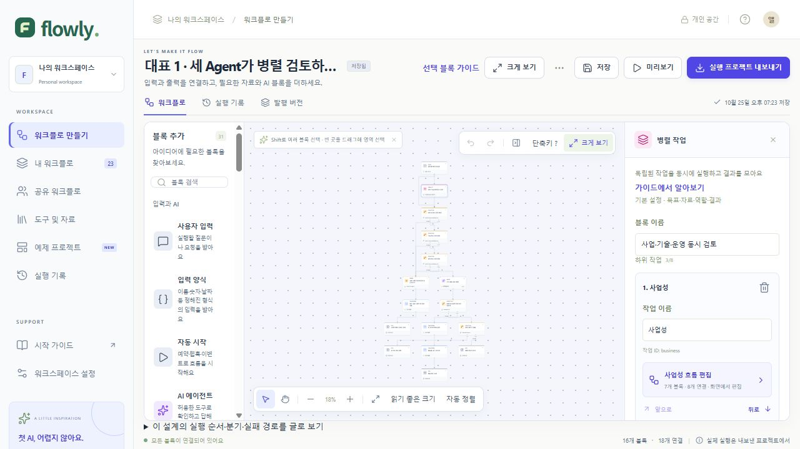
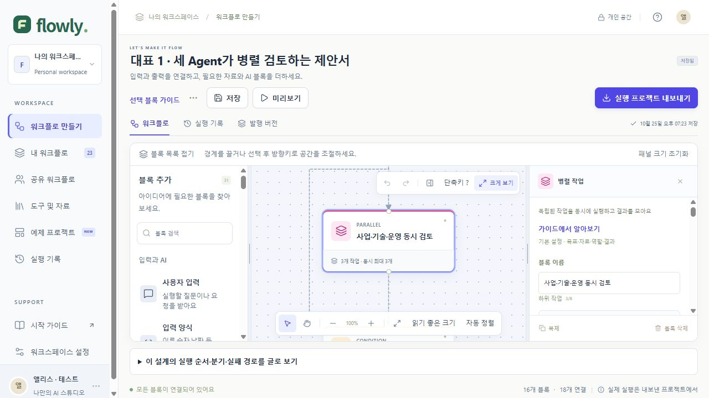
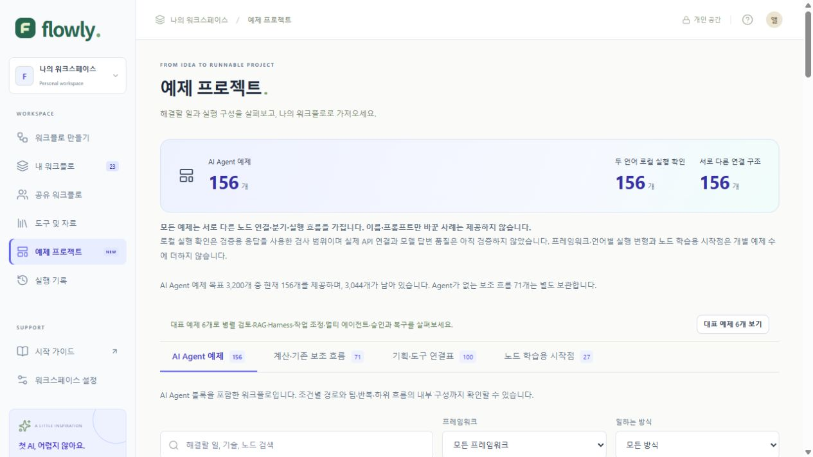
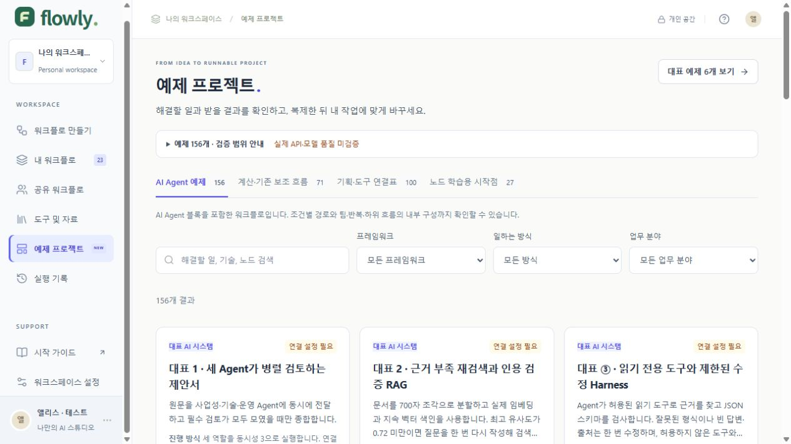
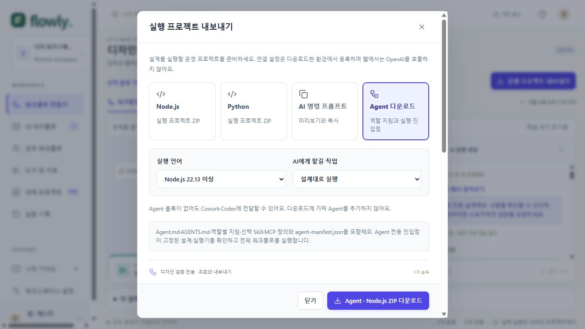

# 디자인·운영용 내보내기 화면 검증 · 2026-10-26

실제 로컬 Workers 앱을 브라우저에서 확인했다. 자동 단위 테스트와 별도의 시각 확인이다. 원본은 `C:/Users/ght11111/.codex/visualizations/2026/10/26/flowly-design-implementation`에 보관한다. 아래 비교는 같은 1280×720 viewport의 같은 대표 병렬 예제다. 변경 전에는 전체 흐름 맞춤, 변경 후에는 읽기 좋은 100%를 표시한다. 확대율 변화와 스크롤·패널 구조가 비교 대상이며 노드 설계 자체는 수정하지 않았다.

## 편집기 전후

수정 전:

수정 후:

설정창 마지막 항목까지 내부 스크롤 가능. 경계 마우스 드래그·방향키, 전체 흐름 보기·읽기 크기, 휠 확대·이동·영역 선택·키보드 이동·실행 취소를 실제 화면에서 확인했다. 임시 합성 워크플로로 연결 추가·되돌리기와 중첩 초안 복구를 검사했으며 기존 사용자의 저장 설계는 바꾸지 않았다.

추가 화면: [1440×900](design-production/after-editor-1440.jpg), [1920×1080](design-production/after-editor-1920.jpg), [800×720 좁은 창](design-production/after-editor-800.jpg), [조회 전용 두 패널](design-production/readonly-editor-1280.jpg).

좁은 창의 캔버스는 290px, 설정 패널은 220px로 늘렸으며 페이지를 세로로 스크롤한다. 시각 비교 이미지의 일부는 브라우저가 스크롤바를 제외하여 캡처한 크기다. CSS viewport와 저장 이미지 픽셀 크기를 구분한다.

## 예제 첫 화면 전후

수정 전:

수정 후:

통계·목표·검증 세부 사항은 펼침 영역으로 옮기고 검색·선택과 예제 카드를 우선 배치했다. 실제 API 미검증 안내는 항상 보인다. 최신 패키지 증거가 있는 대표 6개만 Node/Python 로컬 실행 확인으로 표시하며 나머지를 검증 완료로 표시하지 않는다.

## 목록·내보내기

[내 워크플로 제목·작업 버튼과 권한 표시](design-production/after-workflows-1280.jpg)

조회자 계정으로 Agent 없는 합성 흐름의 Agent ZIP을 실제 다운로드했다. 언어·작업 목적과 하단 다운로드 버튼을 확인했다. 파일 내용·설계 일치·두 언어 실행은 자동 ZIP 검증 결과와 함께 판단한다.

## 검증 한계

- 브라우저 확대 단축키가 in-app 자동화에서는 확대율을 바꾸지 않아 실제 125%·150% 확대는 미검증이다. 800px 창 확인으로 대신 통과 처리하지 않는다.
- 프롬프트 생성·복사 완료 UI와 복사 함수 테스트는 확인했다. 자동화의 가상 클립보드와 페이지 클립보드가 분리되어 외부 앱 붙여넣기 왕복은 검증하지 못했다.
- 실제 OpenAI·MCP·운영 SSO 연결, 화면 읽기 프로그램과 다른 브라우저 조합은 검증하지 않았다.
- 로컬 로그인·가이드·공유 목록·중첩 편집기의 추가 캡처는 위 원본 폴더에 있다.

전체 구현·명령·검증 수치는 [통합 기록](../DESIGN_PRODUCTION_IMPLEMENTATION.md)에 정리했다.
