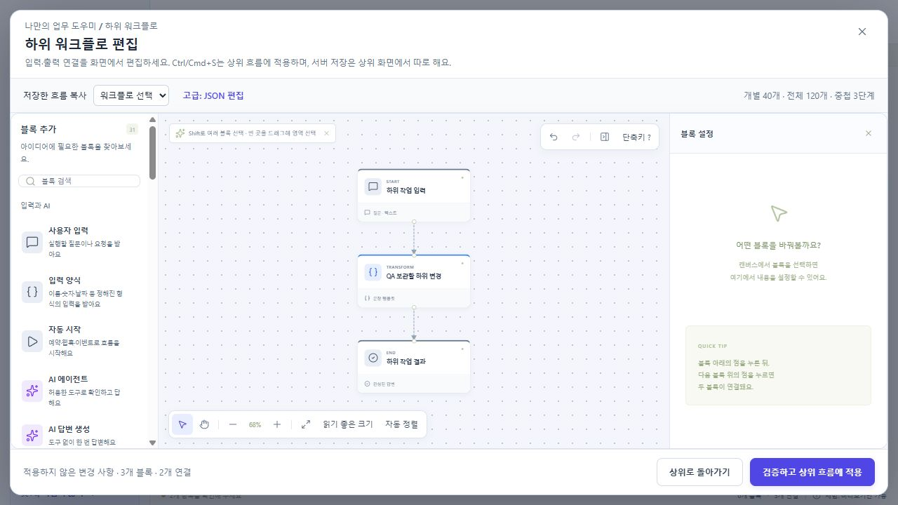
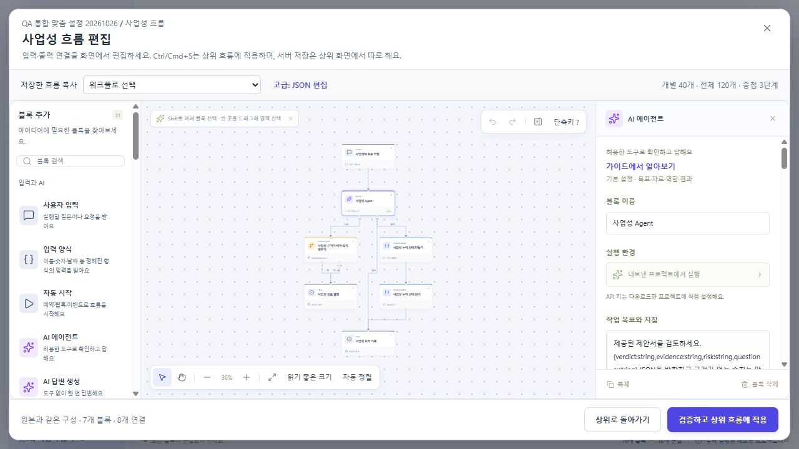

# 통합 편집기·예제 사용 흐름 검증

검증일: 2026-10-26. 로컬 `http://127.0.0.1:5173`, 별도 QA 탭과 고정 로컬 테스트 사용자 Alice를 사용했다. 실제 OpenAI·MCP 서비스 또는 자격 증명은 사용하지 않았다. 아래 결과는 화면 상호작용과 로컬 저장 검증이며 실제 AI 실행 성공을 의미하지 않는다.

## 가이드와 하위 편집 초안

- 데모 편집기에서 블록 이름을 바꾸고 Prompt 도움말을 열었다 닫아도 변경한 이름과 설계가 유지되었다.
- 하위 워크플로에서 입력 블록 이름을 변경한 뒤 ‘초안 보관하고 닫기’를 선택했다. 같은 하위 흐름을 다시 열어 ‘하위 초안 복구’를 실행했을 때 수정한 이름이 복구되었고, 검증 후 상위 흐름에 적용되었다.
- 하위 편집기 안에서 가이드를 열고 Escape를 누르면 두 창이 동시에 닫히던 결함을 발견했다. 최상위 대화상자만 키를 처리하도록 공통 Modal과 하위 편집 키 처리를 수정했다.
- 새 빌드에서 저장된 QA 사본의 ‘사업성 흐름 편집’ → Agent 가이드 → Escape를 재검증했다. 가이드는 닫히고 하위 편집기는 유지되었다(대화상자 개수: 가이드 0, 하위 편집기 1).

## 예제 복제와 맞춤 설정

- 로그인 후 ‘대표 1 · 세 Agent가 병렬 검토하는 제안서’를 열었다. 서비스 설정이 없는 상태에서도 ‘복제해서 시작하기’로 복제할 수 있었다.
- 목표 → 자료 → 역할 → 결과 → 완료 조건의 다섯 단계를 확인했다. QA 사본의 이름과 실제 ‘사업성 Agent’ 작업 지침을 변경하고 저장했다.
- 편집기에서 해당 병렬 작업의 하위 흐름을 열어 수정한 작업 지침이 실제 Agent 설정에 반영되었음을 확인했다.
- ‘내 워크플로’에서 사본은 ‘읽기: 나만 · 수정: 소유자’, 마지막 수정자 `test:alice`로 표시되었다. 새 빌드로 새로고침한 뒤에도 사본과 변경 사항이 유지되었다.

## 자동 검사와 보존 범위

- 편집기·데이터 계약 관련 자동 검사 41개 통과: `tests/nondeveloper-editor.test.ts`, `tests/editor-composition.test.ts`, `tests/editor-operations.test.ts`, `tests/data-contract.test.ts`, `tests/work-styles.test.ts`.
- 담당 파일 ESLint 검사 통과. 마지막 Modal 회귀 수정 후 `common.tsx`, `nested-editor.tsx`, `workflow-guide.tsx` ESLint를 다시 통과했다.
- 이번 UI 검증에서 생성한 유일한 사본 `flow_89e2626c-4e45-4f8c-bc16-4c2461951e14`(`QA 통합 맞춤 설정 20261026`)만 정확한 ID와 소유자를 확인하고 정리했다. 이 예제는 새 자료를 복제하지 않았다. 정리 후 기존 워크플로 23개 및 자료 목록은 유지되었다.
- 읽기 전용 캔버스 조작은 자동 검사 범위에 포함했다. 다중 사용자 공유 화면·전체 예제·두 실행기 검증 결과는 통합 담당자의 별도 검사 결과를 참조한다. 이번 브라우저 검증만으로 해당 범위를 완료했다고 판단하지 않는다.
