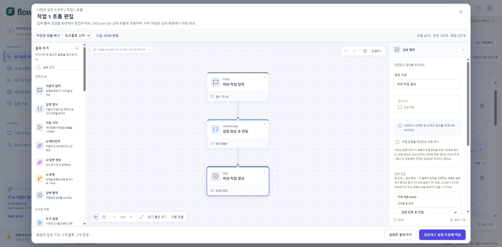

# 하위 워크플로 시각 편집 검증

검증일: 2026-10-25. 로컬 Workers 빌드의 `/demo#editor`에서 별도 검증 탭을 사용했다. 저장 API를 호출하지 않고 데모의 임시 편집본만 조작했다. OpenAI·MCP 등 실제 외부 서비스 호출은 없었다.

## 자동 검증

- `pnpm exec tsx --test tests/editor-composition.test.ts tests/editor-operations.test.ts`: 21/21 통과.
- 변경한 편집기 파일의 ESLint 통과. 마지막 JSON 변경 보호를 포함한 통합 TypeScript 검사도 통과했다.
- 순환 연결·잘못된 분기·연결 80개 제한, 동일한 형제 흐름의 원자적 교체, 전체 120개·중첩 3단계 제한, 중첩 자동 시작 차단을 검사했다.
- 정렬·균등 간격, 사용자별 초안 구분과 자료/연결 목록 제외, 진단의 대상 블록 연결, 적용 전 유효/잘못된 JSON의 변경 감지를 검사했다.

## 브라우저에서 확인한 동작

1. 병렬 작업의 하위 흐름이 JSON 대신 팔레트·캔버스·설정 화면으로 열린다. 등록된 자료 선택기, 입력 연결과 출력 형식 설정을 사용할 수 있다.
2. 블록 이름 변경을 취소하면 원본이 유지되고, 적용 후 다시 열면 변경 내용이 유지된다. 연결되지 않은 블록이 있으면 적용을 거절하고 오류를 표시한다.
3. 하위 흐름에서 추가 후 Ctrl+Z, Ctrl+A, Escape가 해당 편집기에만 적용된다. 중첩 하위 흐름의 Escape는 가장 안쪽 창만 닫는다.
4. 진단의 블록 버튼이 해당 설정을 열고 캔버스를 이동시킨다. 선언한 출력 필드가 다음 블록의 입력 선택기에 표시된다. boolean 출력을 string 입력에 연결하면 형식 불일치 안내가 표시된다.
5. 마우스 휠로 68%에서 160%로 확대했고, 전체 보기로 연결 포트를 확인했다. 정상 연결 후 역방향 연결을 시도했을 때 순환 오류를 표시하고 연결 수를 늘리지 않았다.
6. 편집 초안 보관 상태를 표시했다. 브라우저 오류 로그는 비어 있었다.
7. 최종 빌드를 별도 Chrome 데모 탭에서 재확인했다. 시각 구성은 바꾸지 않은 상태에서 잘못된 JSON만 입력해도 닫기와 Escape에서 폐기 확인을 표시한다. 계속 편집하면 입력 원문을 유지하고, 화면 편집으로 전환할 때도 별도로 JSON 폐기 확인을 표시한다. 명시적으로 폐기한 뒤 원래 3개 블록·2개 연결을 유지했다. JSON 편집 중 저장 흐름 복사는 비활성화된다.
8. JSON 편집 중 Ctrl+S는 먼저 JSON 반영을 안내하며 상위 적용을 하지 않는다. 시각 편집에서 블록 이름 변경 후 Ctrl+S를 누르면 하위 창이 닫히고 상위 설계에 적용된다. 다시 열어 변경된 이름을 확인했으며 저장된 워크플로 수는 0개로 유지됐다. 최종 화면의 도움말도 상위 적용과 서버 저장의 차이를 설명한다. 최종 브라우저 오류 로그는 비어 있었고 검증용 탭을 닫았다.

## 검증 한계

- 자동화 브라우저에서 페이지 이탈 확인이 있는 실제 새로고침을 확정할 수 없어, 새로고침 후 복구 배너를 클릭하는 전체 경로는 아직 브라우저 검증에 포함하지 않는다. 초안 데이터의 사용자 격리·복호화·검증은 자동 테스트를 통과했다.
- 하위 편집기의 아직 적용하지 않은 변경은 메모리에만 보관한다. 상위 흐름에 적용한 변경부터 탭의 초안 복구에 포함된다. 중첩 편집을 닫거나 페이지를 떠날 때 변경 폐기 확인을 표시한다.
- Windows Chrome에서 Ctrl+S를 직접 검증했다. macOS의 Cmd+S는 동일 분기 구현이며 해당 OS에서 별도 검증하지 않았다.

